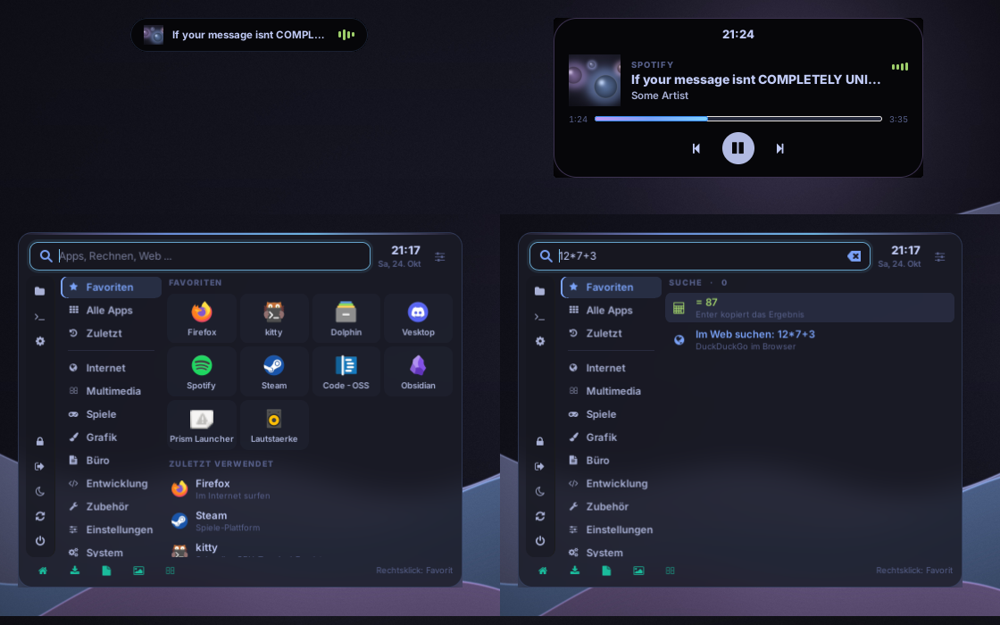

# claudes-glassy (Catppuccin Glass)

Catppuccin Mocha + Glas-Look (Transparenz, starker Blur, runde Ecken,
rotierender Mauve/Blau/Pink-Rahmen, federnde Animationen).
Gebaut fuer Hyprland 0.55+ mit Lua-Config.

## Bestandteile

| Teil            | Programm  | Datei                                   |
|-----------------|-----------|-----------------------------------------|
| Compositor      | Hyprland  | ~/.config/hypr/hyprland.lua             |
| Bar             | Waybar    | ~/.config/waybar/config.jsonc, style.css|
| Launcher/Menues | Rofi 2.x  | ~/.config/rofi/config.rasi              |
| Benachrichtig.  | SwayNC    | ~/.config/swaync/config.json, style.css |
| Sperrbildschirm | Hyprlock  | ~/.config/hypr/hyprlock.conf            |
| Idle            | Hypridle  | ~/.config/hypr/hypridle.conf            |
| Terminal        | Kitty     | ~/.config/kitty/kitty.conf              |
| Wallpaper       | awww/swww/swaybg | ~/.config/hypr/scripts/wallpaper.sh |

## Installation

Ein Befehl (klont nach ~/.local/share/claudes-glassy und startet den Installer):

    bash -c "$(curl -fsSL https://raw.githubusercontent.com/femboyss/claudes-glassy/main/get.sh)"

Oder manuell:

    git clone https://github.com/femboyss/claudes-glassy
    cd claudes-glassy
    bash install.sh

Der Installer zeigt ein Menue (Installieren / Backup wiederherstellen / Abbrechen)
und fragt vor der Installation, ob ein Backup angelegt werden soll (Standard: ja).
Backups landen in ~/.config-backup-catppuccin-glass-<datum>.

Zurueck zum alten Setup:

    bash ~/.local/share/claudes-glassy/install.sh --restore

Listet alle Backups, du waehlst eins aus.

Update: denselben Ein-Befehl nochmal ausfuehren.

## Tastenkuerzel

| Kuerzel                    | Aktion                                  |
|----------------------------|-----------------------------------------|
| SUPER antippen / SUPER + A | Startmenue                              |
| SUPER + Space / R          | Suche (Apps, Fenster, Befehle)          |
| CTRL + ALT + Entf          | Sitzungs-Bildschirm (inkl. Screenshot)  |
| CTRL + SHIFT + Esc         | Task-Manager                            |
| SUPER + Return             | Kitty                                   |
| SUPER + E / B              | Dateimanager / Firefox                  |
| SUPER + Q                  | Fenster schliessen                      |
| SUPER + F / SHIFT + F      | Vollbild / Maximieren                   |
| SUPER + T                  | Schwebend an/aus                        |
| SUPER + C                  | Fenster zentrieren                      |
| SUPER + SHIFT + P          | Fenster anpinnen                        |
| SUPER + J                  | Split drehen                            |
| SUPER + Pfeile             | Fokus                                   |
| SUPER + SHIFT + Pfeile     | Fenster verschieben                     |
| SUPER + ALT + Pfeile       | Groesse aendern                         |
| SUPER + 1..0               | Workspace                               |
| CTRL + SUPER + links/rechts| Vorheriger / naechster Workspace        |
| CTRL + SUPER + SHIFT + l/r | Fenster mitnehmen                       |
| SUPER + Tab                | Letzter Workspace                       |
| SUPER + SHIFT + 1..0       | Fenster auf Workspace (folgen)          |
| SUPER + ALT + 1..0         | Fenster auf Workspace (bleiben)         |
| SUPER + S                  | Scratchpad anzeigen                     |
| SUPER + CTRL + S           | Fenster in den Scratchpad parken        |
| SUPER + F1 / F2 / F3       | Zu Monitor DP-3 / HDMI-A-1 / DP-1       |
| SUPER + SHIFT + F1..F3     | Fenster auf diesen Monitor schieben     |
| SUPER + . / ,              | Naechster / vorheriger Monitor          |
| SUPER + SHIFT + . / ,      | Fenster auf naechsten / vorherigen Mon. |
| ALT + Tab                  | Naechstes Fenster                       |
| SUPER + O                  | Liste aller offenen Fenster             |
| SUPER + W                  | Wallpaper-Auswahl mit Vorschau          |
| SUPER + SHIFT + W          | Zufaelliges Wallpaper                   |
| SUPER + V                  | Zwischenablage-Verlauf                  |
| SUPER + N                  | Benachrichtigungs-Zentrum               |
| SUPER + L                  | Sperren                                 |
| SUPER + Escape             | Kleines Power-Menue                     |
| SUPER + SHIFT + B / R      | Bar ein/aus / neu starten               |
| SUPER + SHIFT + C          | Farbpipette                             |
| Print / SUPER + SHIFT + S  | Screenshot Bereich                      |
| SHIFT + Print              | Screenshot Monitor                      |

## Aufbau

- `~/.config/hypr/hyprland.lua` laedt die Module aus `~/.config/hypr/glassy/`
  (keybinds, monitors, env, look, animations, rules, autostart) einzeln und abgesichert.
  Ein Fehler in einem Modul stoppt die anderen nicht und erscheint als Benachrichtigung.
- Wallpaper: `~/Pictures/Wallpapers` (mitgeliefert: Unterordner `claudes-glassy`).
- Startmenue: eigene GTK4-App im Tokyo-Night-Look (`~/.config/hypr/startmenu/startmenu.py`),
  Aufbau nach Linux Mint + KDE Kickoff: Suche oben, System-Knoepfe links, Kategorien,
  Favoriten-Raster, Zuletzt verwendet, Orte unten. Favoriten per Rechtsklick oder in
  `~/.config/hypr/pinned-apps`. Faellt auf ein Rofi-Menue zurueck, wenn GTK4 fehlt.
  Fehler-Log: `~/.cache/claudes-glassy/startmenu.log`

- Dynamic Island (`~/.config/hypr/island/island.py`): schwarze Pille oben in der Mitte.
  Zeigt die Uhr, bei Musik Cover + Titel + Balken; klappt bei Songwechsel, Maus drueber
  oder Klick auf (Cover, Fortschritt, Zurueck/Pause/Weiter). Lautstaerke-Aenderungen
  erscheinen kurz als Balken. Neu starten: `~/.config/hypr/scripts/island.sh restart`
- Startmenue-Einstellungen: Regler-Symbol oben rechts im Menue (Profilbild, Uhr,
  Zuletzt verwendet, Beschreibungen, Kategorie-Hover). Die Suche kann auch rechnen
  (`12*7+3`) und im Web suchen.
- Zwischenablage (SUPER+V): Entf loescht einen Eintrag, Shift+Entf alles.

- Bar: Start-Knopf + Suchleiste links, laeuft auf allen Monitoren; Menues oeffnen sich auf dem Monitor, auf dem du klickst.
- Sperrbildschirm-Avatar: `~/.face` (sonst Standardbild).

## Anpassen

- Eigene Sachen in ~/.config/hypr/custom.lua, dann bleibt hyprland.lua updatefaehig.
- Monitore: Abschnitt MONITORE in hyprland.lua (Ausgabe von `hyprctl monitors`).
- Weniger GPU-Last: in hyprland.lua `blur.passes` auf 2 und die `borderangle`-Animation auf `enabled = false`.
- Mehr/weniger Glas: `background_opacity` in kitty.conf, `opacity` in der Regel `glass-apps`,
  `alpha(@base, 0.45)` in waybar/style.css.

## Quellen

- Hyprland Lua-Config: https://wiki.hypr.land/Configuring/Start/
- Variablen (Blur usw.): https://wiki.hypr.land/Configuring/Basics/Variables/
- Fensterregeln: https://wiki.hypr.land/Configuring/Basics/Window-Rules/
- Layer-Regeln: https://wiki.hypr.land/configuring/core/rules/layer-rules/
- Dispatcher: https://wiki.hypr.land/Configuring/Basics/Dispatchers/
- Catppuccin Farben: https://catppuccin.com/palette

## Doktor (wenn etwas komisch ist)

    bash ~/.local/share/claudes-glassy/doctor.sh            # pruefen, Bericht in ~/glassy-doctor.txt
    bash ~/.local/share/claudes-glassy/doctor.sh --repair   # veraenderte/fehlende Dateien aus dem Repo zurueckholen

Prueft Hyprland-Config-Fehler, laufende Dienste, fehlende Pakete und vergleicht jede
Config-Datei mit dem Repo. `--repair` sichert die alten Versionen vorher und laesst
`custom.lua`, `pinned-apps`, Avatar und Startmenue-Einstellungen in Ruhe.

## Anima Engine / Desktop-Pets (Windows-Apps ueber Proton)

Schwarzer statt durchsichtiger Hintergrund kommt von Wine/Proton, nicht von Hyprland.
Abhilfe: GE-Proton (ab GE-Proton11-6) verwenden und in Steam bei den Startoptionen eintragen:

    WINE_LAYERED_OVERLAY_SHAPE=1 %command%

GE-Proton installieren: `yay -S protonplus` (oder ProtonUp-Qt), dann in Steam unter
Eigenschaften -> Kompatibilitaet auswaehlen. Die Fensterregeln fuer Anima Engine
(kein Rahmen, keine Ecken, kein Schatten) sind schon in `glassy/rules.lua`.
