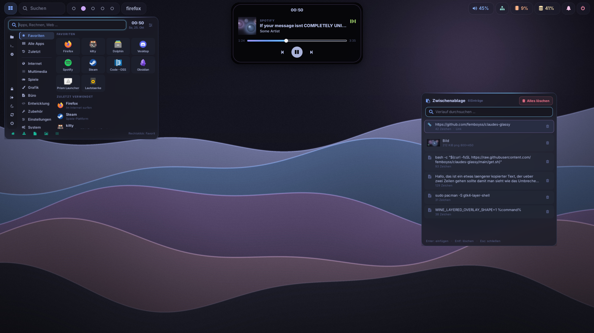
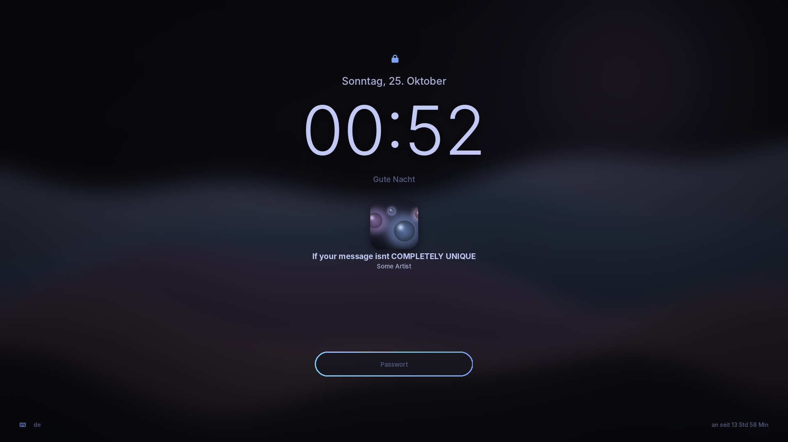
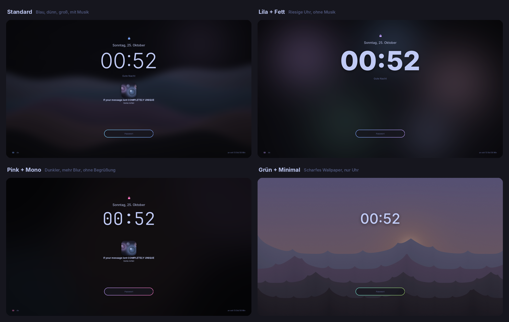
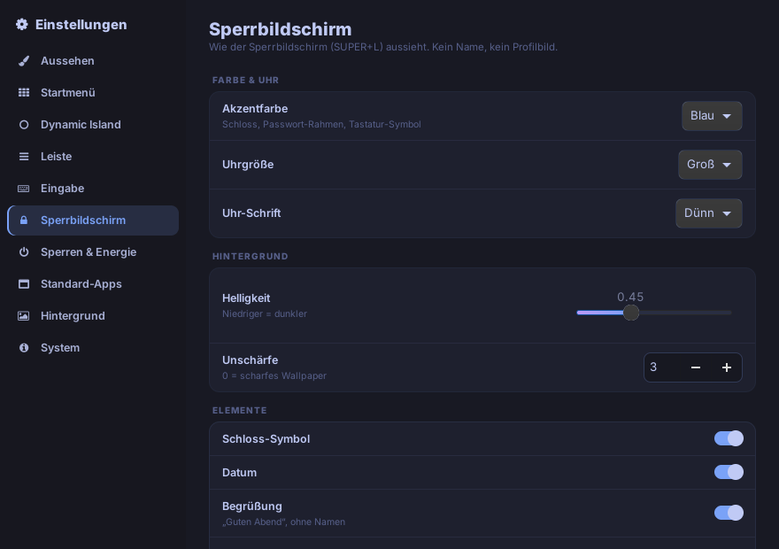

# claudes-glassy

A glassy Hyprland rice for Arch Linux: Catppuccin Mocha + Tokyo Night, lots of blur,
rounded corners, a Windows/macOS-style start menu, a Dynamic Island, a clipboard manager,
screen recording and a settings app. Built for **Hyprland 0.55+ (Lua config)**.

> The user interface (menus, settings, notifications) is in German.
> Deutsche Anleitung: [ganz unten](#deutsch).

## Install / update

    bash -c "$(curl -fsSL https://raw.githubusercontent.com/femboyss/claudes-glassy/main/get.sh)"

This clones (or hard-updates) the repo to `~/.local/share/claudes-glassy` and starts the
installer. The installer has a menu (install / restore backup / cancel), asks whether to back
up your current configs (default: yes) and whether to install packages via pacman.

After the first install you have the `glassy` command (in `~/.local/bin`, added to PATH for fish and bash):

| Command | What it does |
|---------|--------------|
| `glassy --update` | Get the latest **stable** version (branch `main`) and install it |
| `glassy --debug` | Get the **test** version (branch `debug`) and install it |
| `glassy --upgrade` | Install the update for your current channel (main or debug) |
| `glassy --check` | Look for updates now (`--notify` as a notification) |
| `glassy --whatsnew` | What's new on GitHub / the latest changes |
| `glassy --status` | Installed version, and whether main/debug have something newer |
| `glassy --doctor` / `--repair` | Check / repair configs, services, packages |
| `glassy --restore` | Restore a backup from before the install |
| `glassy --settings` | Open the settings app (same as SUPER+I) |
| `glassy --reload` | Restart bar, island, start menu, clipboard |

Bug fixes land on `debug` first. Test them with `glassy --debug`; once they work they go to
`main`, and `glassy --update` brings you back to the stable channel.

- Restore your previous setup: `bash ~/.local/share/claudes-glassy/install.sh --restore`
- Something broken? `bash ~/.local/share/claudes-glassy/doctor.sh` (add `--repair` to fix)
- Your own Hyprland additions go to `~/.config/hypr/custom.lua` (never overwritten)

## Features

| Part | What it does |
|------|--------------|
| **Hyprland** | Lua config split into isolated modules (`~/.config/hypr/glassy/`). An error in one module shows a notification instead of killing your keybinds. |
| **Bar** (Waybar) | Glass "islands", start button, search pill, workspaces, on every monitor. |
| **Start menu** | GTK4 + layer-shell, Tokyo Night. Search (also calculator `12*7+3` and web search), categories (switch on click), favorites, recently used, places, power buttons with confirm. Runs as a background service, opens instantly on the monitor under your mouse. |
| **Dynamic Island** | Black pill at the top: clock, now playing with cover art, expands on hover with seek slider and controls, volume OSD, recording indicator (click = stop). |
| **Update notifications** | Checks GitHub in the background (on login, then hourly/6 h/daily). A notification with "Install now / What's new / Later" - or installs automatically. All in SUPER+I -> Updates. |
| **Taskbar flyouts** | Built in, no external apps: quick settings (Wi-Fi, Bluetooth, do not disturb, night light, airplane mode, power profile, volume, mic, brightness, media), sound (devices + per-app volume), Wi-Fi (connect with password, forget), Bluetooth (scan, pair, connect, battery), calendar (click the island). Same views in SUPER+I. |
| **Settings** (SUPER+I) | Every option in one place: appearance, start menu, island, bar, input, lock & power, default apps, wallpaper, update/doctor/backup. |
| **Clipboard** (SUPER+V) | Search, image previews, trash button per entry, "delete all", opens at the mouse cursor. |
| **Ctrl+Alt+Del** | Fullscreen glass screen: lock, log out, sleep, recording, screenshot, task manager, reboot, UEFI, shut down. |
| **Screenshots** | Screen freezes while you select an area. Saved + copied. |
| **Screen recording** | wf-recorder, area or monitor, with or without desktop audio, NVENC when available. |
| **Lock screen** | hyprlock: big clock, German date, now playing, gradient password pill. No name, no avatar. Fully customizable in SUPER+I. |
| **Wallpapers** | 5 bundled 4K wallpapers, picker with previews, smooth transitions (awww/swww). |
| **Notifications** | SwayNC in the same glass style (also Discord images/actions). |

### Lock screen

Default look:

Everything is customizable in SUPER+I -> Sperrbildschirm. Four examples:

Lock screen options: accent color, clock size and font, brightness, blur, and toggles for lock icon,
date, greeting, now playing, keyboard layout/uptime, fading password field, clock on other monitors.

## Keybinds

| Keys | Action |
|------|--------|
| SUPER (tap) | Start menu |
| SUPER+A | Quick settings |
| SUPER+Space / SUPER+R | Search (apps, windows, commands) |
| SUPER+I | Settings |
| SUPER+V | Clipboard |
| CTRL+ALT+Delete | Session screen |
| CTRL+SHIFT+Esc | Task manager |
| SUPER+Return | Terminal |
| SUPER+E / SUPER+B | File manager / browser |
| SUPER+Q | Close window |
| SUPER+F / SUPER+SHIFT+F | Fullscreen / maximize |
| SUPER+T | Toggle floating |
| SUPER+C | Center window |
| SUPER+SHIFT+P | Pin window |
| SUPER+J | Toggle split |
| SUPER+Arrows | Move focus |
| SUPER+SHIFT+Arrows | Move window |
| SUPER+ALT+Arrows | Resize window |
| SUPER+1..0 | Workspace 1..10 |
| SUPER+SHIFT+1..0 | Move window to workspace (follow) |
| SUPER+ALT+1..0 | Move window to workspace (stay) |
| CTRL+SUPER+Left/Right | Previous / next workspace |
| SUPER+Tab | Last workspace |
| SUPER+S / SUPER+CTRL+S | Show scratchpad / move window there |
| SUPER+F1..F3 | Focus monitor DP-3 / HDMI-A-1 / DP-1 |
| SUPER+SHIFT+F1..F3 | Move window to that monitor |
| SUPER+. / SUPER+, | Next / previous monitor |
| ALT+Tab / SUPER+O | Next window / list of all windows |
| Print / SUPER+SHIFT+S | Screenshot (area) |
| SHIFT+Print | Screenshot (monitor) |
| SUPER+ALT+R | Start / stop screen recording |
| SUPER+W / SUPER+SHIFT+W | Wallpaper picker / random wallpaper |
| SUPER+N | Notification center |
| SUPER+L | Lock |
| SUPER+Escape | Small power menu |
| SUPER+SHIFT+B / SUPER+SHIFT+R | Toggle bar / restart bar + island |
| SUPER+SHIFT+C | Color picker |

## Files

| Path | Content |
|------|---------|
| `~/.config/hypr/hyprland.lua` | Loads the modules in `~/.config/hypr/glassy/` |
| `~/.config/hypr/glassy-settings.json` | Your settings from SUPER+I (re-applied after every update) |
| `~/.config/hypr/custom.lua` | Your own additions |
| `~/.config/hypr/pinned-apps` | Start menu favorites (one `.desktop` id per line) |
| `~/.config/hypr/startmenu/`, `island/`, `clipboard/`, `settings/` | The GTK4 apps |
| `~/.cache/claudes-glassy/*.log` | Logs (start menu, island, clipboard, screenshot, recording) |

## Anima Engine / desktop pets (Windows apps via Proton)

A black instead of transparent background comes from Wine/Proton, not Hyprland. Use
GE-Proton (GE-Proton11-6 or newer) and set the Steam launch options to:

    WINE_LAYERED_OVERLAY_SHAPE=1 %command%

Window rules for Anima Engine (no border, rounding, shadow) are already included.

## Sources

- Hyprland Lua config: https://wiki.hypr.land/Configuring/Start/
- Layer rules: https://wiki.hypr.land/configuring/core/rules/layer-rules/
- gtk4-layer-shell: https://github.com/wmww/gtk4-layer-shell
- Tokyo Night: https://github.com/folke/tokyonight.nvim
- Catppuccin: https://catppuccin.com/palette
- GE-Proton overlay patch: https://github.com/GloriousEggroll/proton-ge-custom/pull/553

---

## Deutsch

Ein Hyprland-Rice im Glas-Look fuer Arch Linux: Catppuccin Mocha + Tokyo Night, viel Blur,
runde Ecken, Startmenue wie bei Windows/macOS, Dynamic Island, Zwischenablage,
Bildschirmaufnahme und eine Einstellungs-App. Fuer **Hyprland 0.55+ (Lua-Config)**.

### Installieren / Aktualisieren

    bash -c "$(curl -fsSL https://raw.githubusercontent.com/femboyss/claudes-glassy/main/get.sh)"

Holt (oder aktualisiert hart) das Repo nach `~/.local/share/claudes-glassy` und startet den
Installer. Der hat ein Menue (Installieren / Backup wiederherstellen / Abbrechen), fragt nach
einem Backup deiner Configs (Standard: ja) und ob Pakete per pacman installiert werden sollen.

Danach gibt es den Befehl `glassy`:

| Befehl | Was er macht |
|--------|--------------|
| `glassy --update` | Neuesten **stabilen** Stand holen (Branch `main`) und installieren |
| `glassy --debug` | **Test**-Stand holen (Branch `debug`) und installieren |
| `glassy --upgrade` | Update fuer deinen aktuellen Kanal (main oder debug) installieren |
| `glassy --check` | Jetzt nach Updates suchen (`--notify` als Benachrichtigung) |
| `glassy --whatsnew` | Was ist neu auf GitHub / die letzten Aenderungen |
| `glassy --status` | Was ist installiert, gibt es auf main/debug etwas Neueres? |
| `glassy --doctor` / `--repair` | Configs, Dienste, Pakete pruefen / reparieren |
| `glassy --restore` | Backup von vor der Installation zurueckspielen |
| `glassy --settings` | Einstellungen oeffnen (wie SUPER+I) |
| `glassy --reload` | Leiste, Island, Startmenue, Zwischenablage neu starten |

Fixes kommen zuerst auf `debug`. Mit `glassy --debug` testen; wenn alles passt, landen sie
auf `main`, und `glassy --update` bringt dich wieder auf den stabilen Stand.

- Altes Setup zurueck: `bash ~/.local/share/claudes-glassy/install.sh --restore`
- Etwas kaputt? `bash ~/.local/share/claudes-glassy/doctor.sh` (mit `--repair` reparieren)
- Eigene Hyprland-Ergaenzungen: `~/.config/hypr/custom.lua` (wird nie ueberschrieben)

### Was drin ist

- **Hyprland:** Lua-Config in abgesicherten Modulen. Ein Fehler zeigt eine Benachrichtigung,
  statt die Tastenkuerzel lahmzulegen.
- **Leiste (Waybar):** Glas-Inseln, Start-Knopf, Suchfeld, Workspaces, auf jedem Monitor.
- **Startmenue:** GTK4, Tokyo Night. Suche (auch Rechner `12*7+3` und Websuche), Kategorien
  (Wechsel per Klick), Favoriten, Zuletzt verwendet, Orte, Power-Knoepfe mit Bestaetigung.
  Laeuft als Dienst, oeffnet sofort auf dem Monitor unter der Maus.
- **Dynamic Island:** Uhr, Musik mit Cover, klappt beim Drueberfahren auf (Spulen per
  Schieberegler, Steuerung), Lautstaerke-Anzeige, Aufnahme-Anzeige (Klick = Stopp).
- **Update-Benachrichtigung:** sucht im Hintergrund auf GitHub (beim Login, dann stuendlich /
  alle 6 Std / taeglich). Benachrichtigung mit "Jetzt installieren / Was ist neu / Spaeter" -
  oder installiert automatisch. Alles in SUPER+I -> Updates.
- **Flyouts der Leiste (eingebaut, keine externen Apps):** Schnelleinstellungen (SUPER+A: WLAN,
  Bluetooth, Nicht stoeren, Nachtlicht, Flugmodus, Energieprofil, Lautstaerke, Mikrofon,
  Helligkeit, Musik), Sound (Geraete + Lautstaerke pro App), WLAN (verbinden mit Passwort,
  vergessen), Bluetooth (suchen, koppeln, verbinden, Akku), Kalender (Klick auf die Island).
  Dieselben Ansichten gibt es in SUPER+I unter Sound, Netzwerk und Bluetooth.
- **Einstellungen (SUPER+I):** alles an einem Ort: Aussehen, Startmenue, Island, Leiste,
  Eingabe, Sperren & Energie, Standard-Apps, Hintergrund, Update/Doktor/Backup.
- **Zwischenablage (SUPER+V):** Suche, Bild-Vorschau, Muelleimer pro Eintrag, "Alles
  loeschen", oeffnet an der Maus.
- **Strg+Alt+Entf:** Vollbild-Glas mit Sperren, Abmelden, Energiesparen, Aufnahme,
  Screenshot, Task-Manager, Neustart, UEFI, Herunterfahren.
- **Screenshots:** Bildschirm friert beim Auswaehlen ein, wird gespeichert und kopiert.
- **Bildschirmaufnahme (SUPER+ALT+R):** Bereich oder Monitor, mit/ohne Ton, NVENC wenn moeglich.
- **Sperrbildschirm:** grosse Uhr, deutsches Datum, laufende Musik, Passwort-Pille. Kein Name,
  kein Profilbild. In SUPER+I -> Sperrbildschirm anpassbar: Akzentfarbe, Uhrgroesse und -schrift,
  Helligkeit, Unschaerfe und welche Elemente angezeigt werden.
  Beispiele: siehe Bilder oben unter "Lock screen".
- **Wallpaper:** 5 eigene 4K-Wallpaper, Auswahl mit Vorschau, weiche Uebergaenge.
- **Benachrichtigungen:** SwayNC im Glas-Look (auch Discord mit Bildern/Aktionen).

Alle Tastenkuerzel stehen oben in der Tabelle "Keybinds" (gleiche Tasten).

### Anima Engine / Desktop-Pets (Windows-Apps ueber Proton)

Schwarzer statt durchsichtiger Hintergrund kommt von Wine/Proton. GE-Proton (ab 11-6)
verwenden und in Steam bei den Startoptionen eintragen:

    WINE_LAYERED_OVERLAY_SHAPE=1 %command%
